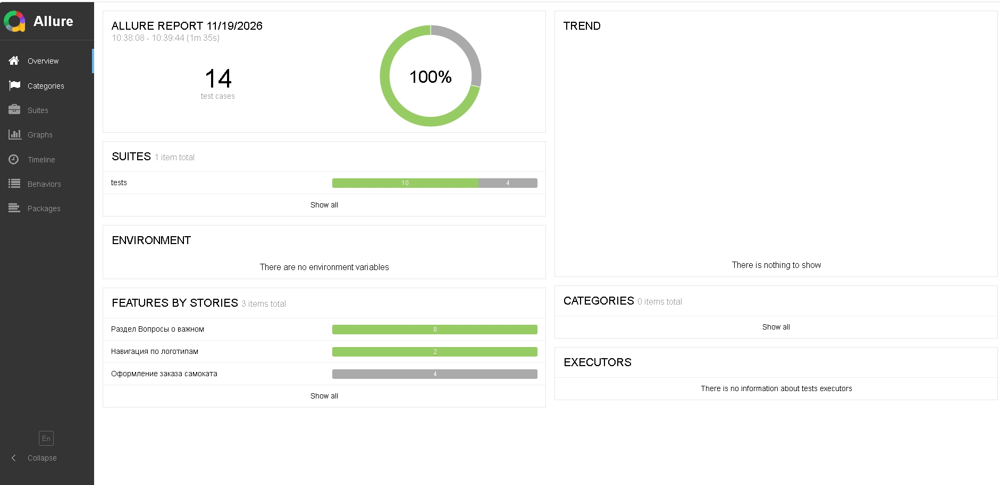

# Яндекс.Самокат

## Что тестирует проект

Тесты проверяют функционал сайта [Яндекс.Самокат](https://qa-scooter.praktikum-services.ru):
- Главная страница и навигация
- Заказ самоката
- Личный кабинет
- Форма заказа
- Модальные окна

## Технологии

- Python 3.11+
- Playwright (UI-тесты)
- Pytest
- Allure (отчетность)
- Pytest-Playwright
- MyPy (статическая типизация)
- Docker

## Установка и запуск

```bash
# Клонировать репозиторий
git clone https://github.com/Ruslan711/yandex_samokat_ruslan.git
cd yandex_samokat_ruslan

# Создать виртуальное окружение
python -m venv venv
source venv/bin/activate  # на Windows: venv\Scripts\activate

# Установить зависимости
pip install -r requirements.txt

# Установить браузеры Playwright
playwright install
```

## Запуск тестов

```bash
# Запуск всех тестов
pytest

# Запуск на определенном окружении
pytest --env=dev
pytest --env=stage

# Запуск в определенном браузере
pytest --browser=chromium
pytest --browser=firefox
pytest --browser=webkit

# Запуск с маркерами
pytest -m smoke
pytest -m regression
```

## Allure-отчёт

```bash
# Открыть отчёт в браузере
allure serve allure-results

# Сгенерировать отчёт в папку
allure generate allure-results -o allure-report --clean
```



## Playwright-отчёт

```bash
# Открыть Playwright HTML-отчёт
playwright show playwright-report
```

## Запуск в Docker

Запустить Docker Desktop.

```bash
docker compose up --build
```

Отчеты сохраняются в `allure-results` и `playwright-report`.